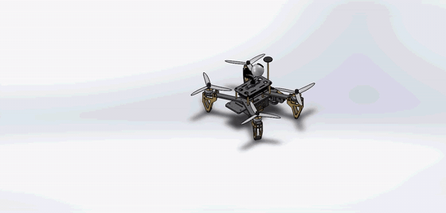
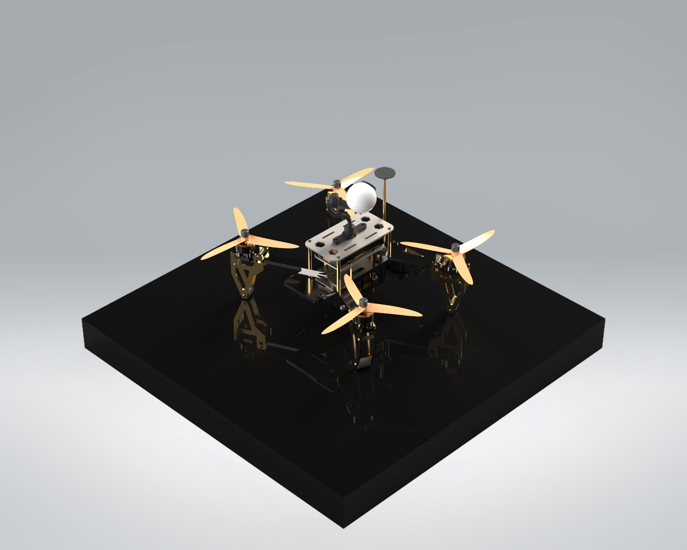
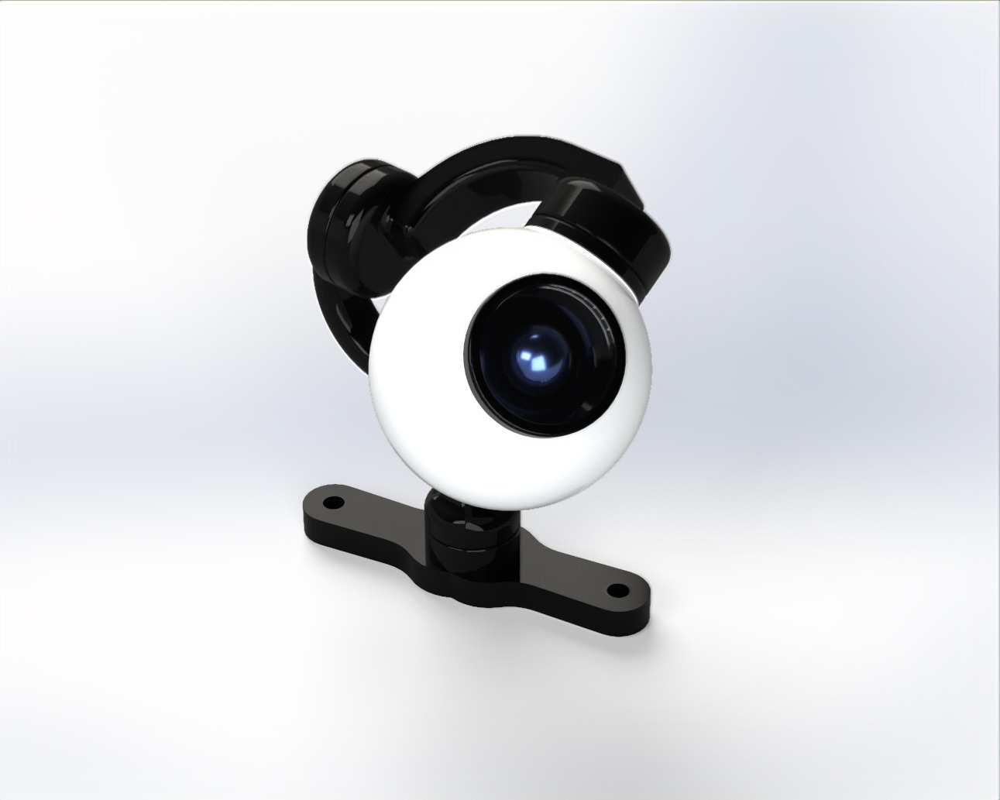
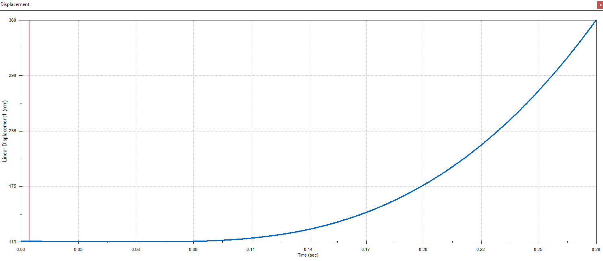
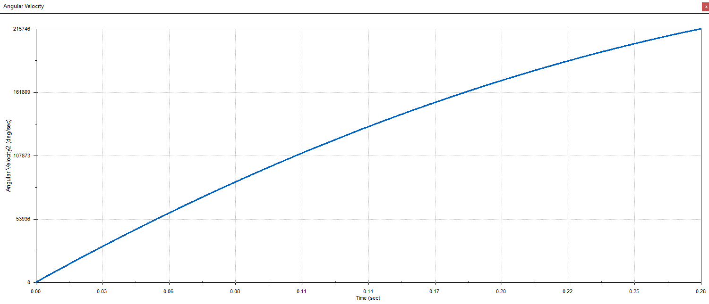

# PX4 Camera Drone: SolidWorks Design and Analysis

A complete quadcopter assembly in SolidWorks, with a gimbal camera, GPS mast, LiDAR and tracking camera, taken through motion, stress and sustainability studies.

<p align="center"></p>

**Course:** MEE 351 Computer-Aided Design, Lebanese American University (Fall 2024)
**Team:** Khalid Kaddoura, Vartan Fakhreddine

## What I did

- Modeled my half of the parts, marked **(K)** in the file names (the **(V)** parts are my teammate's):
  battery frame and spacer · companion computer and antenna · flight-controller frame and spacer · GPS, GPS base, mount, long rod and screw cap · landing leg and spacers · LiDAR and LiDAR mount · T265 frame · servo motor cover · camera sphere and camera base arm.
- Built the full drone and gimbal-camera assemblies with my partner, with renders and an exploded-view animation.
- Ran motion, stress and sustainability studies on the design, setting propeller speed from the thrust each motor needs to lift off.

<p align="center">
  
  
</p>

## Analysis

| Study | Setup | Result |
|---|---|---|
| Mass | Full assembly | 1,255 g |
| Motion (take-off) | 3.08 N per motor to hover; 5 N per motor applied to climb | ≈ 16,530 rpm propeller speed |
| Static stress (V-bracket) | Cast carbon steel, 5 N thrust from each of two motors | 64.2 MPa peak von Mises, minimum FoS 3.87, 0.048 mm max displacement |
| Sustainability | SolidWorks Sustainability, CML method | Largest impacts: companion computer, camera sphere, flight controller |

<p align="center">
  
  
</p>

## Repository structure

```
cad/        SolidWorks parts and assemblies (open Assembly Drone.SLDASM)
renders/    SolidWorks Visualize renders of the parts
analysis/   stress and sustainability reports, motion-study plots
docs/       full project report
media/      animation GIF, exploded-view and take-off videos
```

## Reference

The design was modeled after open GrabCAD references, with the camera dimensions modified for this build:
[Drone Race PX](https://grabcad.com/library/drone-race-px-1) · [DJI-style gimbal with camera](https://grabcad.com/library/dji-style-gimbal-with-camera-1)

## Tools

SolidWorks (part modeling, assemblies, Motion Analysis, Simulation, Sustainability) · SolidWorks Visualize

Portfolio: [khalidkadd1.github.io](https://khalidkadd1.github.io)
